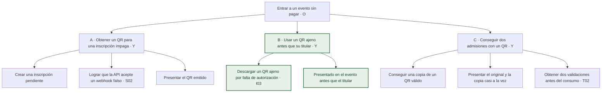

# Árbol de ataque de EventosU

**Objetivo:** entrar a un evento sin pagar una entrada propia. El árbol supone que el acceso normal se concede cuando la App de Puerta recibe una validación positiva de la API del evento.

Un nodo **O** se cumple cuando funciona cualquiera de sus ramas. Un nodo **Y** requiere que se cumplan todos sus pasos.

## Comparación de rutas

| Ruta | Esfuerzo estimado | Qué tendría que fallar |
| --- | --- | --- |
| A · Webhook falso (F11) | Medio | La API debe aceptar una notificación no auténtica y asociarla a la inscripción pendiente. El atacante debe conocer el formato y la referencia esperados. |
| **B · QR ajeno (F07 y F10)** | **Bajo · ruta de menor costo** | El atacante necesita una cuenta ordinaria, un identificador de inscripción ajena que pueda obtener y un QR que siga sin usar. F07 debe omitir la verificación de pertenencia de la inscripción. |
| C · Validación simultánea (F10) | Alto | Además de conseguir una copia, se necesitan dos accesos operativos, coordinación y una ventana en la que ambas solicitudes puedan validar antes de que la API registre el consumo. |

El costo se expresa como esfuerzo relativo y considera acceso previo, conocimiento técnico y coordinación. La ruta B requiere una sola cuenta y un solo escaneo, bajo el supuesto de que se pueda obtener un identificador ajeno y llegar antes que el titular. Si esos datos no están al alcance del atacante, debe reevaluarse su costo. Los niveles son estimaciones del diseño de EventosU.
